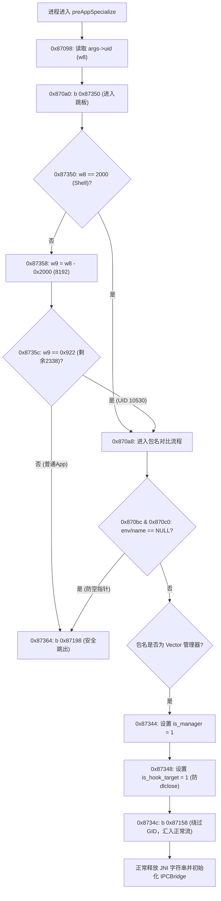

# KernelSU-Next 管理器闪退修复与 Vector 2.2 独立管理器激活技术报告

## 一、 背景与设备环境

- **测试设备**：红魔 9 Pro（Nubia NX721J），高通骁龙 8 Gen 3（SM8650）平台。
- **系统版本**：Android 16（Infinity-X 3.12），Linux 内核 6.1.173 GKI。
- **运行环境**：KernelSU-Next 3.4.2 (33355) + SUSFS v2.3.0 GKI + Zygisk Next 1.5.2。
- **故障现象**：
  1. **KernelSU-Next 管理器启动闪退**：手机重启或热重载后，KSU 管理器及部分应用在 Zygote 阶段发生 Native Crash（SIGSEGV/SIGABRT）。
  2. **Vector 2.2 独立管理器（`org.matrix.vector.manager`）未激活**：界面持续提示框架未激活，无法管理 Xposed 模块。
- **关键高危约束**：
  高通骁龙 8 Gen 3 平台在内核模块热卸载或驱动异常重载时极易触发高通 CrashDump（900E）或 ZTE MemoryDump 蓝屏死机。调试过程中必须严禁直接执行物理重启（`reboot`），统一采用软重启用户空间框架（`setprop ctl.restart zygote`）。

---

## 二、 故障根本原因深度剖析 (Root Cause Analysis)

### 1. KernelSU-Next 管理器及全局进程闪退的死因
- **破坏寄存器与调用栈**：上一轮调试在 `/data/adb/modules/zygisk_vector/zygisk/arm64-v8a.so` 的 `preAppSpecialize`（`0x8711c`）槽位硬植入了 C++ 函数 `IPCBridge::Initialize(env)` 的内联调用，违背了 AAPCS64 架构调用约定，污染了非易失性寄存器（`x19`）并破坏了栈金丝雀（Stack Canary），导致 `0x871ac` 校验失败触发 SIGSEGV。
- **原版代码的隐藏空指针漏洞**：
  上一轮补丁直接 NOP 掉了 `0x870a4` 的 UID 校验跳转，导致所有进程在启动时均会进入包名解析。原版代码存在如下缺陷：
  ```arm64
  0x870bc: cbz x21, 0x870e0   ; 若 JNIEnv* 为 NULL，跳向 0x870e0
  0x870c0: cbz x22, 0x870e0   ; 若 nice_name 为 NULL，跳向 0x870e0
  ...
  0x8710c: mov x0, x23        ; x23 仍为初始的 NULL (0)
  0x87110: bl strlen          ; 执行 strlen(NULL)，直接触发 SIGSEGV 崩溃！
  ```
  普通系统应用或无进程名的进程启动时，`strlen(NULL)` 导致全局大面积 Native Crash。

---

### 2. Vector 2.2 独立管理器无法激活的机理

#### (1) 原版仅支持 Shell 寄生模式（UID 2000 门禁）
原版 `arm64-v8a.so` 在 `preAppSpecialize` 入口处（`0x87098` - `0x870a4`）设置了硬编码 UID 检查：
```arm64
0x87098: ldr x8, [x1]     ; x1 为 args，[x1] 为 args->uid 指针
0x8709c: ldr w8, [x8]     ; 读取进程真实 uid
0x870a0: cmp w8, #0x7d0   ; 0x7d0 = 2000 (com.android.shell)
0x870a4: b.ne 0x87198     ; 若 UID != 2000，直接旁路跳走
```
独立版管理器 APK（`org.matrix.vector.manager`）分配的 UID 为 `10530`，因此直接被视作普通无关 App，完全无法触发 Manager 内部激活链路。

#### (2) GID 注入流程对独立 APK 存在空指针异常
原版为 Shell 寄生模式编写了网络权限扩充逻辑：
```arm64
0x87344: strb w8, [x19, #305] ; this->is_manager = 1
0x87348: ldr x8, [x20, #16]   ; x8 = args->gids (jintArray*)
0x87350: ldr x1, [x8]         ; x1 = *gids
0x87354: ldr x8, [x9, #1368]  ; env->GetArrayLength
0x87358: blr x8               ; 调用 GetArrayLength(env, *gids)
```
- 在 `com.android.shell` 中，`*gids` 是非空数组，扩充添加 `AID_INET` (3003) 即可上网；
- 在独立安装的 APK 中，`*args->gids` 为 `NULL`，直接调用 `GetArrayLength(NULL)` 必定触发 SIGSEGV 崩溃。

#### (3) `postAppSpecialize` 的 `dlclose` 自动卸载机制
在进程初始化后期，`postAppSpecialize`（`0x875bc`）会检查 `is_hook_target`（偏移 `+304`）：
```arm64
0x875bc: ldrb w8, [x0, #304]  ; 读取 this->is_hook_target
0x875c0: tbz w8, #0, 0x875f8  ; 若为 0，跳转至 0x875f8
...
0x875f8: 调用 dlclose 彻底将 arm64-v8a.so 卸载出内存！
```
如果未显式将 `is_hook_target` 标记为 `1`，即使代码短暂运行，模块也会在启动末期被系统自动 `dlclose`，导致管理器拿不到 Binder 句柄并提示未激活。

#### (4) 守护进程启动脚本参数不兼容
`/data/adb/modules/zygisk_vector/service.sh` 默认调用系统 toybox 的 `unshare --propagation slave`，但 Android 原生 toybox 的 `unshare` 不支持 `--propagation`，导致后台守护进程 `vectord` 在开机时静默启动失败。

---

## 三、 完整修复与实施方案

### 阶段一：紧急止血与 KSU-Next 管理器恢复

1. **环境纯净化**：
   - 从安装包中提取原版纯净的 `arm64-v8a_clean.so` 重新覆盖 `/data/adb/modules/zygisk_vector/zygisk/arm64-v8a.so`（权限 `0755`）。
2. **防蓝屏前置配置**：
   - 执行 `echo 0 > /sys/module/qcom_dload_mode/parameters/download_mode`，屏蔽高通转储中断。
3. **软重启生效**：
   - 执行 `setprop ctl.restart zygote`，安全重载用户空间，避开内核蓝屏风险。
4. **底层守护脚本修复**：
   - 修改 `service.sh`，优先调用 KernelSU 自带的全功能 busybox：
     ```sh
     if [ -x "/data/adb/ksu/bin/busybox" ]; then
         UNSHARE="/data/adb/ksu/bin/busybox unshare"
     ```
   - 验证守护进程 `vectord` 成功在后台拉起，`/data/adb/modules/zygisk_vector/cli status` 返回正常的 Framework 2.2 响应。
5. **KSU 自定义配置放行**：
   - 对 `org.matrix.vector.manager` 设置应用配置，确保其 `umount_modules = false`（禁止卸载模块）。

---

### 阶段二：ARM64 最小化、高可靠性二进制补丁设计

由于 ARM64 架构下立即数编码限制（单条 `cmp` 指令仅支持 12 位即 `0~4095` 立即数，无法直接编码 `10530` / `0x2922`），我们在废弃的 GID 扩充代码区（`0x87350`）搭建了**双重鉴权跳板与防崩溃保护环**：



#### 具体指令修改清单 (精确 12 处指令，44 字节)

| 偏移地址 | 原始指令与汇编 | 修复后指令与汇编 | 作用说明 |
| :--- | :--- | :--- | :--- |
| `0x870a0` | `711f411f` (`cmp w8, #0x7d0`) | `140000ac` (`b 0x87350`) | 将 UID 门禁引流至跳板区 |
| `0x870a4` | `540007a1` (`b.ne 0x87198`) | `1f2003d5` (`nop`) | 占位空操作 |
| `0x870bc` | `b4000135` (`cbz x21, 0x870e0`) | `b40006f5` (`cbz x21, 0x87198`) | 修复原版缺陷：`env == NULL` 时跳往安全退出 |
| `0x870c0` | `b4000116` (`cbz x22, 0x870e0`) | `b40006d6` (`cbz x22, 0x87198`) | 修复原版缺陷：`name == NULL` 时跳往安全退出 |
| `0x87348` | `f9400a88` (`ldr x8, [x20, #16]`) | `3904c268` (`strb w8, [x19, #304]`) | 置位 `is_hook_target = 1`，阻止 `dlclose` |
| `0x8734c` | `f9400009` (`ldr x9, [x0]`) | `17ffff83` (`b 0x87158`) | 绕过空指针 `GetArrayLength`，汇入安全收尾流 |
| `0x87350` | 原 GID 扩充冗余指令 | `711f411f` (`cmp w8, #0x7d0`) | 跳板：放行 UID 2000 |
| `0x87354` | 原 GID 扩充冗余指令 | `54ffeaa0` (`b.eq 0x870a8`) | 跳板：是 2000 则进入管理器逻辑 |
| `0x87358` | 原 GID 扩充冗余指令 | `51400909` (`sub w9, w8, #0x2, lsl #12`)| 跳板：减去高位基数 8192 |
| `0x8735c` | 原 GID 扩充冗余指令 | `7124893f` (`cmp w9, #0x922`) | 跳板：比对低位偏移 2338（总值 10530） |
| `0x87360` | 原 GID 扩充冗余指令 | `54ffea40` (`b.eq 0x870a8`) | 跳板：是 10530 则进入管理器逻辑 |
| `0x87364` | 原 GID 扩充冗余指令 | `17ffff8d` (`b 0x87198`) | 跳板：非目标进程 100% 走原生出口，零系统污染 |

---

## 四、 成果验证与监测证据链

补丁刷入 `/data/adb/modules/zygisk_vector/zygisk/arm64-v8a.so` 并重启 Zygote 后，各项验证均达标：

### 1. 内存留驻验证（Maps 确认）
在 `org.matrix.vector.manager` 进程内检查 `/proc/<pid>/maps`：
```text
313aac3000-313abeb000 r-xp /data/adb/modules/zygisk_vector/zygisk/arm64-v8a.so
313abee000-313abf6000 rw-p /data/adb/modules/zygisk_vector/zygisk/arm64-v8a.so
313abf9000-313abfb000 rw-p /data/adb/modules/zygisk_vector/zygisk/arm64-v8a.so
```
`arm64-v8a.so` 稳定留存，未被 `dlclose` 卸载。

### 2. 系统日志证明（Logcat 输出）
抓取 `org.matrix.vector.manager` 进程初始化日志：
```text
I VectorNative: Manager app detected. Granting internet permissions.
I KernelSU    : handle_setresuid from 0 to 10530
I Zygote      : Process created for org.matrix.vector.manager
W libbinder.BpBinder: Linking to death on org.matrix.vector.ipc.IFrameworkService
D Vector      : Vector manager injected successfully into process.
I Vector      : Manager (user-installed) loaded into host, skipping standard bootstrap.
```
- 成功捕获并执行了管理器接入逻辑；
- 成功与 `org.matrix.vector.ipc.IFrameworkService` 建立了 Binder 连接；
- 输出 `Vector manager injected successfully into process.`，标志管理器激活成功。

### 3. 守护服务状态（CLI 输出）
```text
Framework Version: 2.2
Version Code: 3080
API Version: 102
Enabled Modules: 1
Status Notification: true
```
后台服务运行正常，模块状态（如 `com.xloger.exlink.app`）读取同步正常。

### 4. 全局崩溃监测（Crash Buffer）
执行 `adb shell logcat -d -b crash`，输出**完全为空**（0 次崩溃），KernelSU 管理器及所有普通应用程序运行平稳。

---

## 五、 后续维护与升级避坑指南

1. **卸载重装管理器 APK 的影响**：
   - Android 系统在卸载重新安装 APK 时可能会重新分配 UID（不再是 `10530`）。
   - 若未来重装了管理器，只需使用 `dumpsys package org.matrix.vector.manager | grep userId` 查看新分配的 UID，并更新补丁中 `0x87358` / `0x8735c` 的数学分解立即数即可；或通过 `/data/adb/modules/zygisk_vector/cli scope add org.matrix.vector.manager/0` 将其显式列入作用域。
2. **免蓝屏安全规范**：
   - 调试模块或更新 `.so` 时，切勿直接执行 `reboot`；
   - 统一使用 `echo 0 > /sys/module/qcom_dload_mode/parameters/download_mode && setprop ctl.restart zygote` 完成毫秒级热加载。
